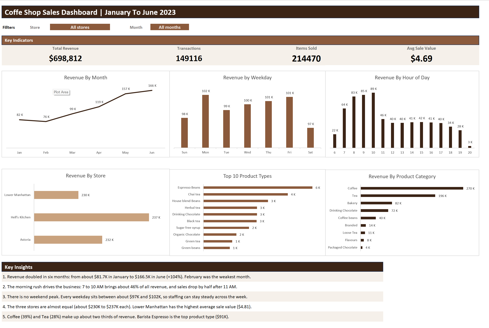

# Coffee Shop Sales Dashboard (Excel)

## Question
When do customers buy the most, and what do they buy?

## Data
- Source: [Maven Analytics Coffee Shop Sales](https://mavenanalytics.io/data-playground/coffee-shop-sales)
- 149,116 transactions from 3 New York stores, January to June 2023

## What I built
- Helper columns: Revenue, Month, Weekday, Hour
- Two dropdown filters (Store, Month) built with Data Validation
- All numbers calculated with SUMIFS / COUNTIFS in a separate Workings sheet, so every chart updates with the filters
- 4 KPIs and 6 charts

## Key insights
1. Revenue doubled from January ($81.7K) to June ($166.5K).
2. 7 to 10 AM brings about 46% of all revenue.
3. No weekend peak: every weekday is between $97K and $102K.
4. The three stores perform almost the same (about $230K to $237K each).
5. Coffee and Tea make up about two thirds of revenue. Barista Espresso is the top product.

## Tools
Microsoft Excel (Data Validation, SUMIFS, COUNTIFS, INDEX/MATCH, charts)
